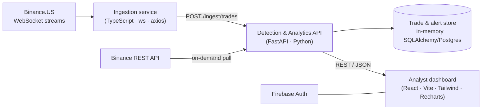

# MarketGeek

**Real-time crypto market-surveillance platform that streams live exchange trades and flags manipulation patterns — wash trading, self-trades, volume-spike anomalies, and circular wallet activity — then surfaces them in an analyst dashboard with compliance-style reporting.**


> **Status:** early-stage prototype (first iteration). The project started as a software-design build and is evolving toward a full market-integrity product. It runs end to end today, but several subsystems are intentionally lightweight — see [Project status](#project-status).

---

## What it does

MarketGeek watches a live feed of cryptocurrency trades and looks for the fingerprints of market manipulation. A lightweight **TypeScript ingestion service** connects to Binance.US trade streams over WebSocket, normalizes every trade into a common shape, and forwards it to a **FastAPI detection engine**. The engine runs several complementary detectors over the trade flow and emits structured **alerts**, **statistics**, and **compliance reports** that a **React + Tailwind dashboard** renders in real time.

The goal is to make abusive trading patterns — the kind that inflate volume or fake liquidity — legible to a human analyst: what happened, on which token and wallets, how confident the system is, and how severe it is.

---

## Features

- **Live trade ingestion** — streams 10 Binance.US markets (BTC, ETH, SOL, XRP, DOGE, SHIB, ADA, AVAX, LTC, LINK) over a multiplexed WebSocket and normalizes each trade into a unified schema.
- **Four detection methods** running over the live feed (details [below](#detection-methods)):
  - Self-trade / same-wallet detection
  - Volume-spike anomaly detection (per-token z-score)
  - Circular trade (wallet cycle) detection
  - Wash-trading heuristic with a 0–100 confidence score
- **One-click Binance pull-and-scan** — fetch recent trades for any symbol directly from the Binance REST API and run wash-trade detection, with a graceful fallback when the API is geo-blocked.
- **Analytics endpoints** — rolling statistics, time-bucketed volume series for charting, and per-token risk summaries.
- **Alerting** — every detection produces a typed `Alert` with severity, confidence, affected addresses, token, volume, and exchange.
- **Compliance reporting** — generates token-specific and global summary reports, a template library (e.g. SEC Rule 10b-5 style), and an audit trail.
- **Analyst dashboard** — a React SPA with dedicated panels for overview, token monitoring, anomaly detection, wallet clustering, compliance reports, and live alerts.
- **Auth** — Firebase authentication on the frontend and JWT-based auth (bcrypt + JOSE) on the backend.
- **Containerized** — a multi-stage Dockerfile builds the React frontend and serves it from the FastAPI backend as a single image.

---

## Architecture



**Data flow:** the ingestion service receives raw Binance trades, maps them to a common `Trade` shape, and POSTs batches to the API. The API stores trades, runs the detectors on demand (or on the ingested stream), and exposes statistics, alerts, and reports that the dashboard polls and visualizes.

---

## Tech stack

| Layer | Technology |
|---|---|
| **Ingestion service** | TypeScript, `ws` (WebSocket), `axios` |
| **Backend / detection** | Python 3.11, FastAPI, Uvicorn, Pydantic, SQLAlchemy, psycopg2 |
| **Auth** | Firebase (frontend), JWT via `python-jose`, password hashing via `passlib[bcrypt]` |
| **Frontend** | React 18, Vite 6, TypeScript, Tailwind CSS v4, Radix UI primitives, Recharts, lucide-react |
| **Data store** | PostgreSQL (AWS RDS) via SQLAlchemy; in-memory store for the live demo path |
| **Infra / deploy** | Docker (multi-stage build), GitHub Actions workflow for Azure Web App container deploy |

---

## Detection methods

All detectors live in `Backend/fastapi_app/detection.py` and `wash_detector.py`.

| Detector | How it works | Output |
|---|---|---|
| **Self-trade** | Flags trades where the sending and receiving wallet are the same address. | High-severity `self_trade` alert (confidence 0.9) |
| **Volume-spike anomaly** | Buckets trades into 5-minute windows per token, computes a z-score against that token's own history, and flags buckets beyond a 3-sigma threshold. | `volume_spike` alert; severity escalates at z ≥ 6 |
| **Wallet cycle** | Builds a directed wallet graph per token and runs a depth-first search for circular paths (A → B → … → A). | `simple_cycle` record with participating wallets and total volume |
| **Wash-trading heuristic** | Scans a symbol's trades for alternating buy/sell pairs in a tight price band with similar sizes, then scores the share of "ping-pong" volume, tight-band ratio, and alternation count into a 0–100 confidence. | `wash_trading` alert with severity and confidence |

The ingestion service can also inject synthetic manipulation patterns (large self-trades and volume spikes) into the live feed so the detectors are demonstrable without waiting for real-world abuse to occur.

---

## API overview

The analytics API (`Backend/fastapi_app/main.py`) exposes 19 endpoints:

**System**
- `GET /health` — service health and version
- `POST /reset` — clear stored trades and alerts

**Ingestion**
- `POST /ingest/trades` — accept a batch of normalized trades

**Statistics & monitoring**
- `GET /statistics/overview` — totals for trades, suspicious trades, wallets, tokens, and wash sales
- `GET /statistics/volume-series` — time-bucketed volume and alert counts for charts
- `GET /tokens/summary` — per-token risk summary

**Detection**
- `POST /detect/self-trades`
- `POST /detect/volume-anomaly`
- `POST /detect/cycles`
- `POST /detect/all-patterns`
- `POST /detect/wash-trading/binance` — pull a symbol from Binance and scan it (with geo-block fallback)

**Analysis & alerts**
- `GET /analysis/token/{token}`
- `GET /analysis/wallet/{address}`
- `GET /alerts`

**Compliance reporting**
- `GET /reports` · `GET /reports/templates` · `GET /reports/case/{token}` · `GET /reports/audit`

**Infra**
- `GET /db-check`

Interactive docs are available at `/docs` (FastAPI / Swagger UI) when the API is running.

---

## Getting started

### Prerequisites
- Node.js 18+
- Python 3.11+
- (Optional) Docker, and a PostgreSQL database if you want persistence

### 1. Detection & analytics API

```bash
cd Backend
python -m venv .venv && source .venv/bin/activate
pip install -r requirements.txt

# The analytics API uses package-relative imports, so run it as a module:
uvicorn fastapi_app.main:app --reload --port 8000
```

API now live at `http://localhost:8000` (docs at `/docs`).

To enable Postgres persistence, create `Backend/.env` (see `AWS/RDS/.env.example` for the full list):

```env
PGHOST=your-postgres-host
PGDATABASE=your-db
PGUSER=your-user
PGPASSWORD=your-password
PGPORT=5432
SSLMODE=require
```

### 2. Live ingestion service

```bash
cd APIs/live-ingestion
npm install
npm start   # compiles TypeScript, connects to Binance.US, and streams trades to the API
```

The target API URL defaults to `http://localhost:8000/ingest/trades` and can be overridden with the `BACKEND_API` environment variable.

### 3. Dashboard

```bash
cd Frontend/frontend-phat
npm install
npm run dev   # Vite dev server, typically on http://localhost:5173
```

### Run the full stack in one container

The multi-stage `DockerFile` builds the React app and serves it from FastAPI:

```bash
docker build -t marketgeek -f DockerFile .
docker run -p 8000:8000 marketgeek
```

---

## Project structure

```
MarketGeek/
├── APIs/
│   └── live-ingestion/      # TypeScript WebSocket ingestion service (Binance.US → API)
├── Backend/
│   ├── main.py              # Container entrypoint: auth + serves built frontend
│   ├── authentication.py    # JWT create/verify, bcrypt password hashing
│   └── fastapi_app/         # Detection & analytics API
│       ├── main.py          # Routes (ingestion, stats, detection, reports)
│       ├── detection.py     # Self-trade, volume-spike, cycle detectors
│       ├── wash_detector.py # Wash-trading heuristic + scoring
│       ├── binance_ingestion.py  # Binance REST pull with geo-block handling
│       ├── schemas.py / models.py # Pydantic trade & alert models
│       ├── storage.py       # In-memory trade/alert store
│       └── db.py            # SQLAlchemy engine/session (Postgres/RDS)
├── Frontend/
│   └── frontend-phat/       # React + Vite + Tailwind dashboard
├── AWS/RDS/                 # Postgres connectivity + env template
├── security/                # nuclei security-scan scaffolding
├── .github/workflows/       # Azure container deploy workflow
└── DockerFile               # Multi-stage build (React → FastAPI)
```

---

## Project status

This is an actively evolving first iteration. A few things to know:

- **Storage:** the live demo path keeps trades and alerts **in memory** (reset via `POST /reset`). SQLAlchemy/Postgres wiring is included for persistence but the detection endpoints currently operate over the in-memory store.
- **Two API surfaces:** `Backend/main.py` is the container entrypoint (auth + serving the built frontend); the feature-rich detection/analytics API lives in `Backend/fastapi_app/main.py`. Consolidating these is on the roadmap.
- **Tests & security scans:** test and security-scan files are scaffolded but not yet implemented.
- **Deploy:** a GitHub Actions workflow for Azure Web App container deployment is included as a template and needs project-specific configuration.

**Roadmap ideas:** persist detections to Postgres, unify the two FastAPI apps, add automated tests, expand beyond Binance to multi-exchange and on-chain (DEX) ingestion, and harden auth and configuration for production.

---

## Disclaimer

MarketGeek is a research / educational project for studying market-manipulation detection. It is **not** financial, legal, or compliance advice, and its alerts are heuristic signals, not determinations of wrongdoing. Do not use it as the sole basis for any trading, regulatory, or enforcement decision.
